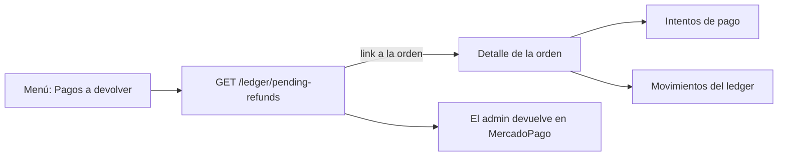

# 02 — Pagos del flujo nuevo en el panel

> **Resumen**
> - **Cambia:** el detalle de la orden muestra los intentos del flujo nuevo y sus movimientos del ledger. Se suma la pantalla "Pagos pendientes de devolver". Se puede cancelar una orden lista para retirar.
> - **No cambia:** el admin nunca edita el estado de un pago: lo actualiza el aviso de MercadoPago.
> - **No incluye:** devoluciones y cambios (spec 03); reporte de saldos.
> - **Decidís vos:** nada.

## Objetivo
Que el panel use el flujo nuevo de pagos y le muestre al admin qué cobró cada orden y qué plata falta devolver.

## Contexto
El backend ya tiene el flujo nuevo, y el viejo se borra en su spec 28, cuando la app y el panel estén migrados. Fuente: `waiona-core/docs/pagos-app-y-panel.md`.

Hoy:
- `services/payment.service.ts` llama a `/payments/order/:orderId`, y `app/(admin)/orders/[id]/page.tsx` muestra esos pagos con `PaymentStatus` y `PaymentProvider`.
- `OrderStatusActions.tsx` no ofrece cancelar desde `DISPATCHED`.
- `apiRequest` (`core/lib/api.ts`) usa `API_URL`, que ya incluye `/v1`.

## Alcance
**Incluye:** intentos y ledger en el detalle de la orden, pantalla de lo que falta devolver, cancelar una orden lista para retirar.
**No incluye:** devoluciones y cambios (spec 03); reporte de saldos (`GET /ledger/balances`); editar un pago.

## Contrato del backend
Todas son solo para `admin` y `super_admin`.

- `GET /payment-attempts/order/:orderId` → `{ id, orderId, status, amount, currency, checkoutUrl, expiresAt, createdAt }[]`, del más nuevo al más viejo. Estados: `NOT_STARTED`, `EXECUTING`, `PENDING`, `UNKNOWN`, `APPROVED`, `FAILED`, `CANCELLED`, `PARTIALLY_REFUNDED`, `REFUNDED`, `CHARGEBACK`.
- `GET /ledger/orders/:orderId` → `{ id, transactionId, sourceKey, account, taxCode, direction, amount, currency, createdAt }[]`. `direction` es `DEBIT` o `CREDIT`. Cuentas: `mp_por_cobrar`, `ventas`, `impuestos`, `fee_mp`, `reembolsos`, `contracargos`, `pagos_a_devolver`.
- `GET /ledger/pending-refunds` → `{ orderId, paymentAttemptId, reason, amount }[]`. `reason` es `EXTRA_PAYMENT` o `CANCELLED_ORDER`.
- `PATCH /orders/:id/status` con `{ status }`. Ahora `dispatched → cancelled` es válido: el stock vuelve al depósito.

## Requisitos funcionales (EARS)
- RF-1: WHEN se abre el detalle de una orden THE SYSTEM SHALL mostrar los intentos en lugar de los pagos viejos, con estado, monto y fecha, usando estas etiquetas: `NOT_STARTED` y `EXECUTING` "Preparando", `PENDING` "Esperando el pago", `UNKNOWN` "Sin confirmar", `APPROVED` "Cobrado", `FAILED` "Falló", `CANCELLED` "Cancelado", `PARTIALLY_REFUNDED` "Devolución parcial", `REFUNDED` "Devuelto" y `CHARGEBACK` "Contracargo".
- RF-2: WHEN se abre el detalle de una orden THE SYSTEM SHALL mostrar una sección "Movimientos" con cada fila del ledger: fecha, cuenta (con `taxCode` si tiene), debe o haber según `direction`, y monto. Sin filas, muestra "Sin movimientos.".
- RF-3: THE SYSTEM SHALL no ofrecer ninguna acción para cambiar el estado de un pago.
- RF-4: WHEN un admin entra a `/payments/pending` THE SYSTEM SHALL listar lo que falta devolver: orden con link al detalle, motivo ("Pago de más" o "Orden cancelada cobrada") y monto. Y SHALL explicar arriba: "Devolvé la plata desde el panel de MercadoPago. El caso desaparece cuando llega el aviso del reembolso.". Sin filas, muestra "No hay pagos pendientes de devolver.".
- RF-5: WHEN se muestra el menú THE SYSTEM SHALL incluir "Pagos a devolver", que lleva a `/payments/pending`.
- RF-6: WHILE la orden está `DISPATCHED` THE SYSTEM SHALL ofrecer "Cancelar" además de "Marcar retirada", con la confirmación existente.
- RF-7: THE SYSTEM SHALL eliminar el servicio y los tipos viejos (`getPaymentsByOrder` de `/payments/order`, `PaymentResponseDto`, `PaymentStatus` y `PaymentProvider` si no se usan en otro lado).

## Edge cases
- **Falla una de las secciones nuevas:** como hoy, un error no controlado va a la pantalla de error de Next. Sin datos parciales.
- **Orden sin intentos:** muestra "Sin pagos registrados.", como hoy.
- **Una orden cancelada cobrada ya devuelta:** no aparece en `/payments/pending`, porque lo decide el backend.

## Diseño técnico
| Archivo | Cambio |
|---|---|
| `services/payment.service.ts` | `getPaymentAttemptsByOrder`. |
| `services/ledger.service.ts` (nuevo) | `getLedgerByOrder` y `getPendingRefunds`. |
| `core/types/payment.types.ts`, `core/types/ledger.types.ts` (nuevo), `core/enums` | Tipos y enums del contrato. |
| `app/(admin)/orders/[id]/page.tsx` | RF-1 y RF-2. |
| `app/(admin)/orders/[id]/OrderStatusActions.tsx` | RF-6. |
| `app/(admin)/payments/pending/page.tsx` (nuevo) | RF-4. |
| `app/(admin)/Nav.tsx` | RF-5. |

Skills: `nextjs-app-router`, `api-integration`, `admin-ui-patterns`, `verification-standard`.

## Verificación
El repo no tiene runner de tests: `npm run lint` y `npm run build`, y prueba manual contra staging de cada RF con una orden cobrada, una con reembolso y una cancelada cobrada.

## Dudas abiertas
Ninguna.

## Implementación
**Rama:** `feat/spec-02-pagos-flujo-nuevo`.

**Archivos:**
- `core/enums/payment.enum.ts`, `core/types/payment.types.ts`, `core/types/ledger.types.ts` (nuevo) y `core/types/index.ts`.
- `services/payment.service.ts` y `services/ledger.service.ts` (nuevo).
- `app/(admin)/orders/[id]/page.tsx`, `app/(admin)/orders/[id]/OrderStatusActions.tsx`, `app/(admin)/payments/pending/page.tsx` (nuevo) y `app/(admin)/Nav.tsx`.

**Decisiones que no estaban explícitas:**
1. Los intentos y el ledger se piden en paralelo.
2. La cuenta se muestra con su nombre técnico (`mp_por_cobrar`), porque el spec no pide traducirla.
3. Los montos nuevos van en formato `es-AR`, como pide la verificación del repo.

**Verificación:** `npx tsc --noEmit`, `npm run lint` y `npm run build`. **Pendiente la prueba manual contra staging** de cada RF.

## Estado
- **Status**: completado
- **Fecha**: 2026-11-09
- **Archivos**: `core/enums/payment.enum.ts`, `core/types/payment.types.ts`, `core/types/ledger.types.ts`, `core/types/index.ts`, `services/payment.service.ts`, `services/ledger.service.ts`, `app/(admin)/orders/[id]/page.tsx`, `app/(admin)/orders/[id]/OrderStatusActions.tsx`, `app/(admin)/payments/pending/page.tsx`, `app/(admin)/Nav.tsx`
- **Verificación manual**: ningún RF verificado en vivo (hace falta login con Auth0 contra staging). RF-1 a RF-7 verificados por lectura de código, `tsc`, lint y build.
