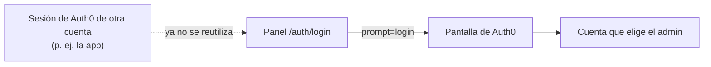

# 04 — El login del panel siempre pide la cuenta

> **Resumen**
> - **Cambia:** al iniciar sesión en el panel, Auth0 siempre muestra su pantalla de login (`prompt=login`), aunque haya otra sesión de Auth0 abierta en el navegador.
> - **No cambia:** la sesión del panel (cookie cifrada, renovación del token), los roles ni la pantalla `/error-login`.
> - **No incluye:** cambios en Auth0 ni en el backend.
> - **Decidís vos:** nada.

## Objetivo
Que el admin entre siempre con la cuenta que escribe, y no con la última que usó el navegador.

## Contexto
Bugfix reportado al probar en local la app (`waiona-app`, spec 16) y el panel en el mismo navegador.

**Causa raíz:** la app y el panel usan el mismo tenant de Auth0, y en el mismo navegador comparten la sesión de Auth0 (la cookie del dominio del tenant). `core/lib/auth0.ts` arma el `Auth0Client` con `authorizationParameters` sin `prompt`, así que `/auth/login` hace SSO: si en el navegador quedó la sesión de una cuenta de cliente creada desde la app, el panel entra con esa cuenta sin preguntar. Si ese mail no está verificado, la Action post-login la frena y el panel termina en `/error-login` con "Te enviamos un email para verificar tu cuenta…", aunque la cuenta de admin esté verificada.

**Blast radius:** todos los caminos que llevan a `/auth/login`: `proxy.ts` (sin sesión o con el refresh vencido), `core/lib/api.ts` (sin token) y el link "Volver a intentar" de `app/error-login/page.tsx`. Todos pasan por `Auth0Client`, así que el cambio en un solo lugar los cubre.

**Fix mínimo:** agregar `prompt: 'login'` a `authorizationParameters`. La app hace lo mismo desde su spec 16.

## Alcance
**Incluye:** `core/lib/auth0.ts`.
**No incluye:** el logout, los roles, `proxy.ts` ni las pantallas de error.

## Contrato del backend
No toca la API. Auth0: parámetro estándar de OIDC `prompt=login` en `/authorize`. Fuente: `waiona-core/docs/auth0-setup.md` (aplicación "Waiona Web").

## Requisitos funcionales (EARS)
- RF-1: WHEN el panel redirige a Auth0 para iniciar sesión THE SYSTEM SHALL mandar `prompt=login`, junto con el `audience` y el `scope` de hoy (`openid profile email offline_access`).
- RF-2: WHILE hay en el navegador una sesión de Auth0 de otra cuenta THE SYSTEM SHALL mostrar igual la pantalla de login de Auth0, sin entrar con esa cuenta.
- RF-3: WHEN el panel renueva el access token con el refresh token THE SYSTEM SHALL seguir haciéndolo sin pedir login (`prompt` solo afecta a `/authorize`).

## Edge cases
- **Sesión de Auth0 de la misma cuenta admin:** igual pide el login. Es el costo aceptado: una pantalla más al entrar.
- **Sesión del panel todavía vigente (cookie):** no pasa por `/auth/login`; no cambia nada.

## Diseño técnico
- `core/lib/auth0.ts`: `authorizationParameters` suma `prompt: 'login'`, con un comentario del motivo.
- Sin cambios de rutas, types, services ni actions.
- Skills: `auth-session`, `verification-standard`.

## Verificación
El panel no tiene `npm test`: la verificación es manual y con build.
- **RF-1:** con el dev server, `curl -s -o /dev/null -w '%{redirect_url}' http://localhost:3001/auth/login` → la URL de `/authorize` incluye `prompt=login`, `audience` y el `scope` completo.
- **RF-2:** en un navegador con la sesión de Auth0 de una cuenta de la app, entrar a `http://localhost:3001` → aparece la pantalla de login de Auth0; con la cuenta admin se entra al dashboard.
- **RF-3:** se comprueba leyendo el SDK: `prompt` solo está en `authorizationParameters`, que se usan en `/authorize`, no en el refresh.
- `npm run lint` y `npm run build` sin errores; `npx tsc --noEmit` limpio.

## Dudas abiertas
Ninguna.

## Implementación
**Rama:** `fix/spec-04-login-siempre-pide-cuenta`.

**Archivos:** `core/lib/auth0.ts` (`prompt: 'login'` en `authorizationParameters`, con comentario) y `specs/INDEX.md`.

**Decisiones que no estaban explícitas:** ninguna.

**Verificación:**
- `npx tsc --noEmit`, `npm run lint` y `npm run build` sin errores.
- **RF-1 (verificado):** con el panel en `next start`, `/auth/login` redirige a `/authorize` con `prompt=login`, `audience=https://api.waiona.com` y `scope=openid profile email offline_access`.
- **RF-3 (verificado leyendo el SDK):** en `@auth0/nextjs-auth0` (`dist/server/auth-client.js`, `getTokenSet`), el refresh toma de `authorizationParameters` solo `scope` y `audience`; `prompt` se usa únicamente al armar `/authorize`.
- **RF-2 (pendiente de probar en el navegador):** con la sesión de Auth0 de una cuenta de la app abierta, entrar a `http://localhost:3001` tiene que mostrar la pantalla de login de Auth0.

## Estado
- **Status**: completado
- **Fecha**: 2026-11-13
- **Archivos**: `core/lib/auth0.ts`
- **Verificación manual**: RF-1 en vivo (`/auth/login` redirige a `/authorize` con `prompt=login`, `audience` y `scope`; Auth0 responde con su pantalla de login `/u/login`). RF-3 solo por lectura del SDK (`getTokenSet` no usa `prompt` en el refresh). RF-2 pendiente de probar en el navegador con una sesión de Auth0 de otra cuenta abierta.
