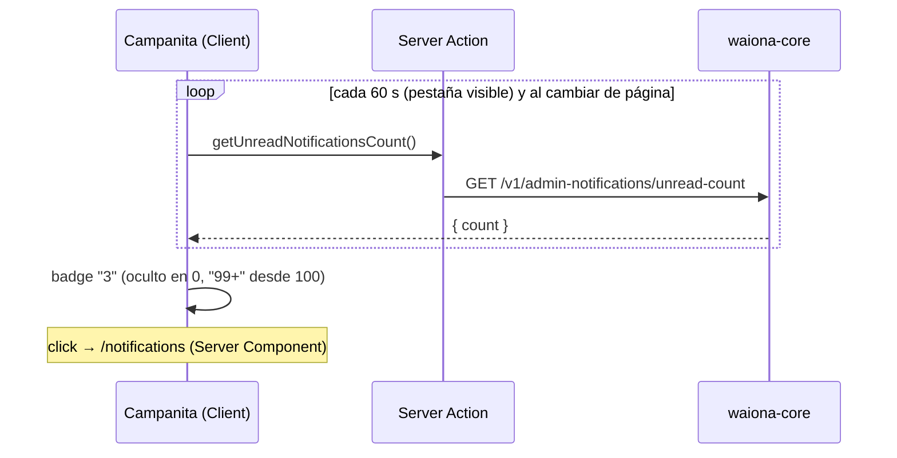

# 05 — Campanita de notificaciones

> **Resumen**
> - **Cambia:** el header del panel muestra una campanita con la cantidad de notificaciones sin leer, que se actualiza sola cada minuto. Al tocarla abre `/notifications`: la lista (hoy, alertas de stock bajo), con filtro "Sin leer / Todas", link al stock y "Marcar como leída" / "Marcar todas como leídas".
> - **No cambia:** ninguna otra pantalla ni el login. El panel no calcula nada: todo sale de la API (spec 34 de `waiona-core`).
> - **No incluye:** sonido, notificaciones del navegador ni otros tipos de notificación.
> - **Decidís vos:** nada. Ya decidiste: sin mail, el contador se actualiza solo.

## Objetivo
Que el admin vea en el panel cuándo un producto queda bajo de stock, sin mails.

## Contexto
Lo pidió el usuario (2026-11-21). El backend dejó de mandar el mail de stock bajo y ahora guarda notificaciones (specs 34 y 35 de `waiona-core`, en `master`): un job cada 15 min abre una por producto, depósito y nivel, contando solo lo reservado por pedidos pagos, y la resuelve sola cuando se repone.

El token de Auth0 nunca llega al navegador (`core/lib/api.ts`, `apiRequest` lo toma de la sesión en el servidor). Por eso la campanita, que es un Client Component, consulta por una Server Action. Referencias: lista paginada en `app/(admin)/orders/page.tsx` (`?page=`, links "Anterior"/"Siguiente"); botón con action + `useTransition` + toast en `app/(admin)/users/UserStatusActions.tsx`; actions con `{ success, message }` en `actions/order.actions.ts`; header en `app/(admin)/layout.tsx`; detalle de stock en `/stock/[id]` (id del ítem de stock).

## Alcance
**Incluye:** campanita en el header, página `/notifications`, types, enum, service y actions.
**No incluye:** entrada en `Nav.tsx` (se entra por la campanita); tests de componentes (el repo todavía no tiene runner).

## Contrato del backend
Todos con rol `admin` o `super_admin` (`client` → 403). Fuente: `waiona-core/specs/34_notificaciones_stock_en_panel.md` y Swagger `/api/docs` (tag *Admin notifications*).

| Método y ruta | Request | Response |
|---|---|---|
| `GET /admin-notifications` | query `page`, `limit` (1–100), `unread` (`true`/`false`, opcional) | `PaginatedResponse<AdminNotification>`, de la más nueva a la más vieja |
| `GET /admin-notifications/unread-count` | — | `{ count: number }` |
| `PATCH /admin-notifications/:id/read` | — | `AdminNotification` (si ya estaba leída, la devuelve igual) · 404 `Notificación no encontrada` |
| `PATCH /admin-notifications/read-all` | — | `{ count: number }` (las que marcó) |

`AdminNotification`: `id`, `type` (`low_stock`), `level` (`minimum` \| `critical` \| `out_of_stock`), `stockItemId`, `productId`, `productName`, `locationId`, `locationName` (los cuatro pueden venir `null` si se borró el producto o el depósito), `quantityAvailable`, `stockMin`, `stockCritical`, `createdAt`, `readAt` (null = sin leer), `resolvedAt` (null = sigue abierta).

## Requisitos funcionales (EARS)
- RF-1: WHEN se carga cualquier página del panel, cada 60 s mientras la pestaña está visible, y al cambiar de página THE SYSTEM SHALL pedir `unread-count` y mostrarlo en la campanita del header: sin número si es 0, el número hasta 99 y "99+" desde 100.
- RF-2: IF pedir el contador falla THEN THE SYSTEM SHALL dejar el último número mostrado, sin toast ni error en pantalla, y reintentar en el siguiente ciclo.
- RF-3: WHEN el admin toca la campanita THE SYSTEM SHALL ir a `/notifications`.
- RF-4: WHEN se abre `/notifications?unread=true|false&page=N` THE SYSTEM SHALL listar las notificaciones de esa página (por defecto `unread=true`, página 1, 20 por página) con: fecha y hora, producto, depósito, nivel ("Mínimo", "Crítico", "Sin stock"), disponible / mínimo / crítico, estado ("Abierta" o "Resuelta el <fecha>") y leída o no; con links "Sin leer" / "Todas" y "Anterior" / "Siguiente".
- RF-5: WHEN el admin toca el producto de una fila THE SYSTEM SHALL ir a `/stock/<stockItemId>`.
- RF-6: WHEN el admin toca "Marcar como leída" en una fila sin leer THE SYSTEM SHALL llamar a `PATCH /:id/read`, deshabilitar el botón mientras tanto, refrescar la lista y el contador de la campanita.
- RF-7: WHEN el admin toca "Marcar todas como leídas" THE SYSTEM SHALL llamar a `PATCH /read-all`, mostrar el toast "Se marcaron N como leídas", refrescar la lista y el contador. El botón solo aparece si hay sin leer.
- RF-8: IF marcar falla THEN THE SYSTEM SHALL mostrar un toast con el mensaje de la API (o "Error de conexión con el servidor") y dejar la fila como estaba.
- RF-9: IF no hay notificaciones para el filtro THEN THE SYSTEM SHALL mostrar "No hay notificaciones sin leer." (o "No hay notificaciones." con "Todas").

## Edge cases
- **Producto o depósito borrado:** mostrar "Producto borrado" / "Depósito borrado" y la fila sin link.
- **Página fuera de rango o `unread` inválido:** se usa página 1 y `unread=true`.
- **Pestaña oculta:** no consulta; al volver a estar visible consulta enseguida.
- **Sesión vencida:** `apiRequest` ya redirige al login; en la campanita cuenta como fallo (RF-2).
- **Doble click en marcar:** el botón queda deshabilitado mientras corre (RF-6).

## Diseño técnico
| Archivo | Cambio |
|---|---|
| `core/enums/notification.enum.ts` (+ barrel) | `NotificationLevel` (`minimum`, `critical`, `out_of_stock`), `NotificationType` (`low_stock`). |
| `core/types/admin-notification.types.ts` (+ barrel) | `AdminNotification`, `UnreadCount`. |
| `services/admin-notification.service.ts` | `getAdminNotifications({ page, unread })`. |
| `actions/admin-notification.actions.ts` | `getUnreadNotificationsCount()` (lectura como Server Action: la campanita es Client y el token no sale del servidor; devuelve `{ success, count }`), `markNotificationRead(id)` y `markAllNotificationsRead()` con `revalidatePath('/notifications')`. |
| `app/(admin)/NotificationBell.tsx` (Client) | RF-1 a RF-3. Escucha el evento `window` `notifications:changed` para volver a pedir el contador. Icono `Bell` de `lucide-react`, `aria-label="Notificaciones"`. |
| `app/(admin)/layout.tsx` | Campanita a la izquierda de `LogoutButton`. |
| `app/(admin)/notifications/page.tsx` (Server) | RF-4, RF-5, RF-9. |
| `app/(admin)/notifications/MarkReadButton.tsx`, `MarkAllReadButton.tsx` (Client) | RF-6 a RF-8; al terminar bien, `dispatchEvent(new Event('notifications:changed'))`. |

**Skills:** `nextjs-app-router`, `api-integration`, `admin-ui-patterns`, `verification-standard`.

## Verificación
El repo no tiene runner de tests: `npm run lint`, `npx tsc --noEmit` y `npm run build`, y prueba manual contra `waiona-core` local con stock bajo:
- RF-1/RF-2: con 3 sin leer se ve "3"; con la API apagada el número queda; con 0 no hay número.
- RF-4/RF-5/RF-9: filtro, paginado, link al stock y lista vacía.
- RF-6/RF-7/RF-8: marcar una y todas (contador baja sin recargar); con un id inexistente, toast con el 404.

## Dudas abiertas
Ninguna.

## Implementación
**Rama:** `feat/spec-05-notificaciones-campanita` (desde `master`, sin commitear).

**Archivos nuevos:** `core/enums/notification.enum.ts`, `core/types/admin-notification.types.ts`, `services/admin-notification.service.ts`, `actions/admin-notification.actions.ts`, `app/(admin)/NotificationBell.tsx`, `app/(admin)/notifications/page.tsx`, `MarkReadButton.tsx`, `MarkAllReadButton.tsx`.
**Modificados:** `core/enums/index.ts`, `core/types/index.ts` (barrels), `app/(admin)/layout.tsx` (campanita a la izquierda de "Cerrar sesión").

**Decisiones que no estaban explícitas:**
1. **El service también tiene `getUnreadNotificationsCount()`**: la página lo usa para mostrar "Marcar todas como leídas" solo si hay sin leer (RF-7), aunque estén en otra página o con el filtro "Todas".
2. **La campanita reinicia su intervalo al cambiar de página** (un solo efecto con `pathname`): consulta al navegar y cada 60 s desde la última navegación. Así no llama a `setState` dentro del efecto (regla `react-hooks/set-state-in-effect` del lint).
3. **`NOTIFICATIONS_CHANGED_EVENT` se exporta desde `NotificationBell.tsx`** y lo usan los dos botones.
4. **Página fuera de rango:** si la página pedida viene vacía y no es la 1, se vuelve a pedir la 1.
5. **Filas leídas en gris** para distinguirlas de las sin leer.

**Verificado:** `npx tsc --noEmit`, `npm run lint` y `npm run build` limpios (`/notifications` en el build). Contrato contra el Swagger de `waiona-core` local (`/api/docs-json`): las 4 rutas, los parámetros `page`/`limit`/`unread` y los 14 campos de la respuesta coinciden; sin token responde 401.

**Sin verificar a mano (requiere loguearse por Auth0 en el navegador):** RF-1 a RF-9 en el dev server. Con la API local hay 2 notificaciones abiertas para probar (FANTA crítico, PEPSI sin stock).

## Estado
- **Status**: completado
- **Fecha**: 2026-11-21
- **Archivos**: `core/enums/notification.enum.ts`, `core/enums/index.ts`, `core/types/admin-notification.types.ts`, `core/types/index.ts`, `services/admin-notification.service.ts`, `actions/admin-notification.actions.ts`, `app/(admin)/NotificationBell.tsx`, `app/(admin)/layout.tsx`, `app/(admin)/notifications/page.tsx`, `app/(admin)/notifications/MarkReadButton.tsx`, `app/(admin)/notifications/MarkAllReadButton.tsx`
- **Verificación manual**: RF-1 a RF-9 probados en vivo por el usuario el 2026-11-21 contra `waiona-core` local (reportó que funciona). El verificador revisó cada RF leyendo el código y confirmó el contrato contra el Swagger local; no pudo loguearse por Auth0 para repetir la prueba. Sin runner de tests en el repo (no hay tests de componentes).
